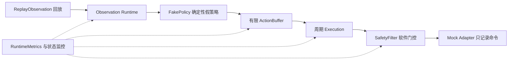

# Phase 5A 接口与执行职责草案

日期：2026-10-26。状态：`DRAFT_FOR_REVIEW`。这是源码对齐和学习材料，尚未冻结消息或执行协议。

## 首个闭环

这是数据流和职责图，不要求每一格单独成为 ROS 节点。监控不能替代执行路径中的有效性检查。
Mock Adapter 不打开串口、不加载真实驱动、不发布到真实控制器。这里的停止只指停止产生模拟命令；物理安全仍需后续独立验证。

模型推理是动作的生产者，执行端是消费者。推理完成时间可以变化；执行端在约定的时刻选择仍然有效的动作。
ActionBuffer 负责有限容量、选取、覆盖和丢弃；Execution 在消费时重新检查有效期；SafetyFilter 保留最终软件门控。
把推理与执行分开后，才能分别观察推理延迟、队列等待和执行抖动。ROS 通信成功本身不能证明这些性质。

## 项目契约与上游比较

以下来源路径均在 `sources/` 下；精确 commit 和原始 URL 见 `upstream_snapshot.json`。
“缺口”表示本次已阅文件没有建立证据，不等于整个上游项目不存在该能力。

| 项目职责 | 本次已阅上游证据 | 差异或未证实项 | Phase 5A 草案约束 |
|---|---|---|---|
| Observation | Rosetta `contracts/so_101.yaml` 提供 topic/type/QoS、hold 对齐、header 时间线、resize 和字段选择 | 该例使用三路 512×512 图像及不同关节名称；不能直接替代 Phase 4 的 wrist 输入与六维状态。hold 的最大允许年龄及项目时钟映射尚未核验 | 保留本项目数据契约；显式记录来源、缺帧、观测年龄及无效原因 |
| PolicyOutput | Rosetta README 说明同一 YAML 映射用于离线数据与策略执行；policy core README 描述通用推理阶段 | 尚未证明其动作块具备本项目 generated_at / valid_until / sequence_id、单位和关节顺序语义 | FakePolicy 先输出确定性动作和可追溯观测关联；动作块索引、重叠与替换规则另行冻结 |
| ControlCommand | SO-ARM101 `ros2_controllers.yaml` 配置 position 接口，机械臂关节与 gripper 分开 | 六维策略输出到机械臂/夹爪的映射、范围和单位不能按数组长度猜测；50 Hz 只是该上游配置 | SafetyFilter 后形成项目命令，设备私有转换留在 Adapter；首轮仅写日志 |
| SafetyState | Feetech `src/feetech_ros2_driver.cpp` 的 on_init → configure_joints_ 会访问串口、写参数，并对有命令接口的关节使能扭矩 | 无本项目 STM32/Zephyr 许可及急停语义的验证证据；初始化不能视为无作用的读取 | 保留 DISARMED / ARMED / RUNNING / DEGRADED / FAULT / SAFE 语义；本轮无真实驱动加载 |
| RuntimeMetrics | 上游样例存在 header / receive 时间线与定时运行描述 | 未建立本项目完整 Age 链、测量点、clock_domain 和同步状态证据 | 先通过 Gate T0 再固化时间戳链；未同步的时钟不直接相减 |
| InferenceBackend | policy core README 公开阶段间使用 Ort::Value；运行节点按 timer 顺序执行各阶段 | 概念上的可换后端不等于符合项目公开接口；内部 ORT 类型不能自动成为项目公共契约。串行 timer 周期不是解耦执行证据 | 保留厂商无关的 Backend 边界；首轮 FakePolicy，无 ACT / OpenVINO 调用 |
| ActionBuffer | policy pipeline README 描述每次 update 中依次预处理、推理、后处理、执行，失败时跳过当前周期 | 这些描述未建立有限 producer/consumer buffer、过期剔除或独立执行节拍 | 项目负责容量、所有权、背压、覆盖/丢弃计数与消费时有效性检查；不照搬串行路径 |

## 建议包职责

沿用执行书 7.1 的包名；这不是已实现或已批准的目录结构。

| 包 | 首轮责任 | 暂留设计问题 |
|---|---|---|
| physical_ai_msgs | 五类项目契约的 ROS 表达 | Gate T0 时钟字段与版本；避免新增第二套数据真相源 |
| observation_runtime | ReplayObservation、输入有效性与观测来源 | replay time 和 host steady time 的映射及重置 |
| policy_runtime | FakePolicy、可控延迟/错误输出；动作交给有限缓存 | ActionBuffer 的节点内所有权、回调隔离与后续 C++ 迁移 |
| runtime_monitor | 完整 timing 事件、丢弃原因、退出证据 | RMW/DDS、QoS、Executor、Callback Group、Lifecycle 身份 |
| safety_bridge | 软件许可与停止状态的 mock 边界 | 不连接 MCU；真实许可、复位和重连留给后续协议 |
| bringup | 仅 mock/replay 的组合及退出顺序 | Execution、SafetyFilter 和 Mock Adapter 的具体宿主待审查 |

## 第一轮验证设计

先完成 SIG-A0 和 T0 设计审查，再编写并冻结可执行协议。下表是待冻结的验证问题，不是运行授权或已通过的测试。

| 场景 | 需要观察的行为 |
|---|---|
| 正常回放 | Observation → PolicyOutput → enqueue/dequeue → mock execute 的关联完整 |
| FakePolicy 延迟 | 执行端不阻塞等待推理；只消费符合时间和动作块约定的有效动作 |
| 动作到期 | 消费时拒绝到期动作，记录 expired 计数；无有效动作时停止模拟命令并记录状态 |
| 队列满 | 容量不增长，按预先定义的覆盖/丢弃规则记录原因 |
| 回放结束、输入失效或节点退出 | 不继续消费残留动作；状态与资源释放可核对 |
| wall clock 跳变或 use_sim_time 变化 | steady 段的超时不受错误时钟比较影响；跨域计算明确拒绝或使用已验证映射 |

消费有效期建议采用半开区间，`now >= valid_until` 即到期；这仍需在协议中确认。
回放前一轮录制的 monotonic 数字不能当成本轮的有效时间；需要保留源时间并明确回放映射。
初始队列策略、周期、有效期、最大运行时长及失败阈值都尚未冻结，不能从上游 50 Hz 或 Phase 4 推理 P50 推导。

## 教学用的一个判断

下面数字只是同一 host steady 时钟域内的例子，不是推荐参数：动作在 0 ms 生成，有效至 100 ms，执行端到 120 ms 才取到。
即使队列非空，该动作也不能执行。到期不由“成功传输”或“模型输出有限数值”抵消。
首次学习检查由用户判断：这个拒绝应该发生在哪个消费环节；如果此时没有任何有效动作，模拟执行端应留下什么证据？

## 尚未解决的接口细节

执行书 9.2 的 initialize/infer/metrics/reset 与 Portability Addendum 02 的 prepare/infer/health/shutdown/capabilities 需要在实现设计中明确映射。
本草案不静默选取其中一组 API，也不宣称 C++ 签名已冻结。源文摘录见 `governing_extracts.txt`，P 编号为 OOXML 段落序号而非页码。
